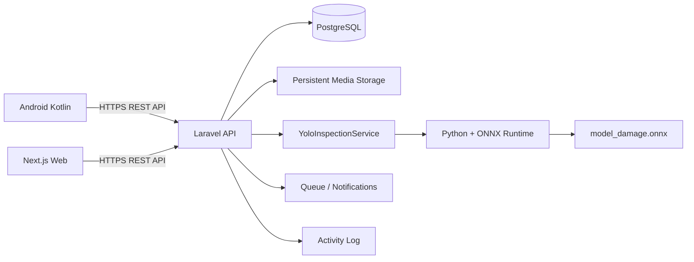

# PRODUCT REQUIREMENTS DOCUMENT (PRD) v2.0 — MOTOLENS

**AI-Powered Used Motorcycle Inspection & Marketplace Ecosystem**  
**Laravel REST API + Next.js App Router + Android Kotlin + YOLOv8 ONNX**

| Metadata | Nilai |
|---|---|
| Produk | MotoLens |
| Dokumen | Product Requirements Document |
| Versi | 2.0 — Revised Agent-Ready |
| Pemilik proyek | I Kadek Deny Aditya Nanda |
| Program | Capstone Mandiri INSTIKI 2026 |
| Status | Spesifikasi pengembangan; beberapa parameter ML dan infrastruktur wajib diverifikasi |
| Bahasa aplikasi | Bahasa Indonesia |
| Zona waktu operasional | Asia/Makassar (WITA) |
| Backend | Laravel REST API |
| Web | Next.js App Router, TypeScript, Tailwind CSS |
| Android | Kotlin, CameraX, Android Location Services |
| Database | PostgreSQL |
| ML runtime | ONNX Runtime + Python/OpenCV |
| Model | YOLOv8n Object Detection, `model_damage.onnx` |

> **PENTING — ATURAN UNTUK AI CODING AGENT**
>
> Dokumen ini adalah sumber spesifikasi utama MotoLens. Sebelum mengubah kode, periksa repository dan artefak aktual. Jangan mengarang file, endpoint, model, kelas, kredensial, atau hasil pengujian.
>
> 1. Pertahankan teknologi dan seluruh fitur produk yang didefinisikan di dokumen ini.
> 2. Jangan mengganti atau melatih ulang model tanpa persetujuan developer.
> 3. Jangan membuat hasil deteksi palsu untuk menyamarkan kegagalan inferensi. Mode mock hanya boleh digunakan dalam test/demo yang diberi label jelas dan tidak boleh disimpan sebagai inspeksi AI nyata.
> 4. Jangan menganggap `Accident` sama dengan `crack`. Gunakan nama kelas yang benar-benar ada pada metadata model.
> 5. Backend Laravel adalah sumber kebenaran untuk autentikasi, otorisasi, inspeksi, harga, listing, booking, dan status data.
> 6. Web dan Android tidak boleh menghitung ulang hasil inspeksi atau harga dengan rumus masing-masing. Keduanya menampilkan hasil dari API.
> 7. Kerjakan per fase. Setelah setiap fase, jalankan pemeriksaan yang relevan, laporkan file yang berubah, hasil test/build, risiko, dan hal yang belum selesai. Tunggu persetujuan developer sebelum berpindah fase.
> 8. Jangan melakukan refactor atau perubahan UI yang tidak diperlukan oleh requirement.
> 9. Jangan pernah memasukkan secret, password produksi, token, atau private key ke repository.
> 10. Jika dokumen, source code, dan artefak model berbeda, hentikan bagian yang terdampak, jelaskan perbedaannya, lalu minta keputusan developer. Jangan memilih diam-diam.

---

# 1. Identitas, Masalah, Tujuan, dan Ruang Lingkup

## 1.1 Identitas Produk

**MotoLens** adalah ekosistem inspeksi dan marketplace motor bekas yang membantu penjual menyajikan kondisi visual kendaraan secara lebih transparan dan membantu pembeli membandingkan unit serta harga.

Tema Capstone:

**MotoLens: Platform Inspeksi & Marketplace Motor Bekas Web-Android dengan Deteksi Kerusakan Bodi (YOLO) dan Taksiran Harga Pintar.**

## 1.2 Masalah yang Diselesaikan

1. Penjual kesulitan menyusun informasi kondisi visual motor bekas secara konsisten.
2. Pembeli sulit membandingkan kondisi visual dan harga beberapa unit.
3. Foto iklan dapat tidak merepresentasikan kondisi aktual kendaraan.
4. Harga yang diminta penjual dapat berbeda dari estimasi referensi sistem.
5. Hasil inspeksi dan perubahan data perlu dapat ditelusuri.

MotoLens membantu mengurangi masalah tersebut melalui pengambilan foto terarah, deteksi kerusakan visual, estimasi harga berbasis aturan yang transparan, sertifikat inspeksi, dan marketplace.

## 1.3 Tujuan Produk

- Menyediakan marketplace motor bekas berbasis web.
- Menyediakan aplikasi Android sebagai alat inspeksi lapangan dan publikasi iklan.
- Mengintegrasikan model YOLOv8 ONNX ke alur utama inspeksi.
- Menampilkan bukti visual berupa foto asli dan foto beranotasi.
- Menghitung estimasi harga menggunakan aturan yang dapat dijelaskan.
- Menyediakan indikator `Good Deal`, `Fair Price`, dan `Overpriced`.
- Menyediakan fitur komparasi motor, booking survei, garasi pengguna, moderasi admin, dan audit log.
- Menjaga konsistensi data di Android dan website melalui satu Laravel REST API.

## 1.4 Batasan dan Klaim Produk

MotoLens bukan aplikasi appraisal profesional dan bukan alat diagnosis mekanis kendaraan.

Model YOLO hanya mendeteksi objek/kerusakan visual yang termasuk kelas pada dataset dan model. Model tidak dapat menyimpulkan kondisi mesin, rangka tersembunyi, keaslian dokumen, riwayat kecelakaan secara pasti, atau keamanan kendaraan secara menyeluruh.

Label harga merupakan **indikator berdasarkan rumus dan referensi sistem**, bukan jaminan harga transaksi pasar.

Pengambilan foto langsung dan GPS meningkatkan keterlacakan proses, tetapi tidak menjamin anti-fraud secara mutlak.

## 1.5 Target Pengguna

| Peran | Kebutuhan |
|---|---|
| Pengunjung | Menjelajahi katalog dan melihat detail listing yang bersifat publik |
| User/Penjual | Registrasi, inspeksi motor, menerbitkan iklan, mengelola garasi, dan menerima booking |
| User/Pembeli | Mencari, memfilter, membandingkan motor, melihat sertifikat, dan mengajukan survei |
| Admin | Mengelola referensi harga, memoderasi listing, memantau aktivitas, dan melihat metrik sistem |

Satu akun `user` dapat bertindak sebagai pembeli maupun penjual. Role admin memiliki hak administratif terpisah.

## 1.6 Persyaratan Wajib Capstone

1. Website Next.js dapat diakses melalui URL publik yang dikonfigurasi.
2. Backend Laravel dapat diakses melalui HTTPS publik yang stabil untuk demo.
3. Tersedia akun demo admin dan user dengan kredensial yang ditetapkan melalui environment/seeder aman.
4. Minimal satu fitur ML nyata memakai `model_damage.onnx` pada alur inspeksi iklan.
5. Seed data minimal 50 listing motor bekas realistis di wilayah Bali, lengkap dengan foto/placeholder yang sah dan hasil inspeksi yang diberi penanda sumber data.
6. Website responsive dan mobile-friendly.
7. Android dapat login, mengambil foto melalui kamera, mengambil lokasi dengan izin pengguna, mengirim inspeksi ke API, menampilkan hasil, dan menerbitkan iklan.
8. Hasil inspeksi dari Android dapat ditampilkan pada website.
9. Test penting untuk autentikasi, otorisasi, inspeksi, estimasi harga, katalog, dan booking tersedia.
10. Demo harus membedakan data hasil inferensi nyata dengan data seed/demo.

## 1.7 URL dan Konfigurasi Deploy

URL awal yang direncanakan:

- Web: `https://motolens-deny.vercel.app`
- API: `https://api-motolens-deny.trycloudflare.com` (contoh endpoint tunnel sementara, bukan jaminan URL permanen).

URL final wajib dibaca dari environment. Jangan hardcode URL tunnel ke source code.

---

# 2. Arsitektur Sistem dan Pembagian Peran Platform

## 2.1 Arsitektur Tingkat Tinggi



### Prinsip arsitektur

- Laravel menjadi pusat business logic dan sumber kebenaran.
- PostgreSQL menyimpan data transaksional.
- Media storage menyimpan foto asli dan foto anotasi secara persisten.
- YOLO dijalankan oleh service inferensi yang dipanggil Laravel.
- Next.js dan Android mengonsumsi kontrak API yang sama.
- Jangan menaruh file model ONNX di bundle frontend atau mengirim file model ke browser.
- Jangan menjalankan proses inferensi berat secara langsung di request web tanpa timeout, validasi, dan pengendalian resource.

## 2.2 Android — Alat Inspeksi Lapangan

Fitur yang dipertahankan:

1. Login dan logout.
2. Demo User Login.
3. Pengaturan Base URL API untuk development/demo.
4. Live Camera AI Scanner menggunakan kamera belakang.
5. Tidak menyediakan pemilihan galeri pada alur inspeksi resmi.
6. Pengambilan GPS dengan izin eksplisit.
7. Form spesifikasi motor.
8. Pengiriman foto dan data ke endpoint inspeksi.
9. Preview hasil bounding box dan ringkasan deteksi.
10. Tampilan perhitungan harga dan indikator harga.
11. Form harga yang diminta penjual.
12. Publikasi listing ke marketplace.
13. Verifikasi/penanganan janji temu COD atau survei sesuai status booking.

### Aturan kamera dan lokasi

- Gunakan CameraX untuk alur kamera dalam aplikasi.
- Simpan waktu pengambilan, koordinat bila diizinkan, akurasi lokasi, dan metadata proses.
- Minta izin kamera dan lokasi pada saat fitur membutuhkannya.
- Jika izin lokasi ditolak, jelaskan konsekuensinya dan ikuti kebijakan produk; jangan mengarang koordinat.
- Jangan menganggap GPS sebagai bukti lokasi yang tidak dapat dimanipulasi.
- Jangan menandai foto sebagai terverifikasi hanya karena berasal dari CameraX.
- Status verifikasi harus mencerminkan pemeriksaan yang benar-benar dilakukan server.
- Untuk demo, tampilkan status verifikasi dan batasannya secara jujur.

## 2.3 Website Next.js — Pembeli dan Penjual

Fitur yang dipertahankan:

1. Katalog interaktif dan filter.
2. Filter merek, tipe, tahun, lokasi, rentang harga, kondisi, dan label harga.
3. Sertifikat Inspeksi AI.
4. Perbandingan foto asli dan foto anotasi.
5. Jumlah deteksi tiap kelas dan confidence yang relevan.
6. Transparansi harga penjual dibanding estimasi sistem.
7. Compare 2–3 unit.
8. Booking jadwal cek unit/survei.
9. Garasi Saya.
10. Pengelolaan listing dan status `available`, `booked`, `sold`.
11. Tampilan responsive desktop dan mobile.

Web boleh menyediakan halaman simulasi inspeksi untuk penguji, sesuai requirement awal. Namun:
- Halaman simulator harus diberi label **Simulasi Inspeksi Web**.
- Upload dari browser tidak boleh ditampilkan sebagai `camera_verified`.
- Endpoint dan pipeline inferensi tetap sama.
- Foto simulator tidak boleh dianggap memiliki bukti pengambilan kamera Android atau GPS lapangan.

## 2.4 Website Admin

Fitur yang dipertahankan:

1. Dashboard analitik pasar.
2. Grafik distribusi label harga.
3. Total listing dan nilai katalog.
4. Statistik deteksi kerusakan.
5. CRUD master harga/model motor.
6. Moderasi listing: approve, reject, remove/disable sesuai kebijakan.
7. Activity Log.
8. Ringkasan aktivitas inspeksi dan performa inferensi.
9. Akun demo admin.

Semua tindakan admin harus dilindungi middleware dan policy backend, bukan hanya penyembunyian menu di frontend.

---

# 3. Spesifikasi Machine Learning

## 3.1 Model Aktual yang Menjadi Acuan

Berdasarkan metadata hasil training yang dicantumkan pada PRD sumber:

| Atribut | Nilai sumber |
|---|---|
| Arsitektur | YOLOv8n Object Detection |
| File | `model_damage.onnx` |
| Input | `1 x 3 x 640 x 640` |
| Ukuran file | sekitar 12.2 MB |
| Dataset | 7.258 citra unik |
| Train | 5.080 citra |
| Validation | 1.088 citra |
| Test | 1.090 citra |
| mAP@50 | 84.34% |
| Precision | 82.52% |
| Recall | 75.92% |
| F1-score | 79.08% |
| mAP@50-95 | 67.54% |

Angka tersebut adalah hasil yang dilaporkan pada dokumen sumber. Sebelum rilis, angka wajib dicocokkan dengan notebook training, hasil evaluasi, file ONNX, dan metadata ekspor yang sebenarnya. Jangan menyebut angka tersebut sebagai hasil verifikasi independen jika artefak belum diperiksa.

## 3.2 Kelas Model

Urutan indeks kelas yang dilaporkan pada dokumen sumber:

| Index | Nama kelas model | Makna yang boleh digunakan |
|---:|---|---|
| 0 | `Accident` | Kategori visual accident sesuai definisi anotasi dataset |
| 1 | `Dent` | Penyok |
| 2 | `Scratch` | Baret/goresan |

**PENTING:** `Accident` tidak boleh otomatis dinamai `crack`. `Accident` hanya boleh dijelaskan sebagai retak jika dokumentasi dataset dan contoh anotasi membuktikan bahwa kelas itu memang khusus retak. Sampai verifikasi dilakukan, gunakan nama `Accident` di backend dan UI dengan penjelasan netral seperti “indikasi kerusakan kategori accident”.

Jangan mengubah label kelas di model tanpa retraining dan ekspor ulang.

## 3.3 Verifikasi Artefak Model Sebelum Integrasi

AI Coding Agent wajib membuat laporan verifikasi:

- File ONNX yang digunakan dan SHA-256.
- Input tensor name, shape, data type, dan layout.
- Output tensor name dan shape.
- Urutan kelas dari metadata/model training.
- Preprocessing: resize/letterbox, RGB/BGR, normalisasi, dan tensor layout.
- Postprocessing: decoding output, confidence, NMS, dan konversi koordinat.
- Versi Ultralytics, ONNX, ONNX Runtime, Python, dan OpenCV.
- Satu atau lebih contoh inferensi yang dapat direproduksi.

Jika metadata kelas tidak tertanam pada ONNX, gunakan satu file konfigurasi metadata yang berversi dan disimpan bersama artefak model.

## 3.4 Threshold dan Konfigurasi Inferensi

Terdapat dua threshold pada PRD sumber: `0.40` pada rumus awal dan `0.35` pada spesifikasi inferensi aktual. Untuk menyatukan implementasi awal, gunakan:

- **Default confidence threshold: `0.35`**, sesuai bagian sinkronisasi model aktual.
- Nilai harus configurable melalui konfigurasi backend, bukan tersebar di kode.
- Catat threshold yang dipakai pada setiap inspeksi.
- Lakukan validasi pada validation/test set sebelum menyatakan threshold optimal.
- NMS IoU threshold harus dicatat dalam konfigurasi model dan tidak boleh diasumsikan tanpa verifikasi pipeline ekspor.

Confidence bukan probabilitas kondisi kendaraan secara keseluruhan.

## 3.5 Format Hasil Deteksi

Setiap deteksi minimal memiliki:

```json
{
  "class_index": 2,
  "class_name": "Scratch",
  "confidence": 0.87,
  "bbox": {
    "x1": 120,
    "y1": 80,
    "x2": 260,
    "y2": 190
  }
}
```

Kontrak koordinat:
- Koordinat API dinyatakan dalam pixel pada gambar sumber, kecuali API secara eksplisit menyatakan format lain.
- Simpan lebar dan tinggi gambar sumber.
- Pastikan koordinat tidak negatif dan tidak melebihi dimensi gambar.
- Frontend harus menskalakan bounding box secara proporsional terhadap gambar yang sedang ditampilkan.
- Jangan menyimpan koordinat normalized sebagai pixel atau sebaliknya tanpa penanda format.

## 3.6 Perhitungan Jumlah Deteksi

- Hitung deteksi setelah preprocessing dan NMS.
- Deteksi hanya dihitung jika confidence memenuhi threshold inspeksi.
- Simpan confidence tiap bounding box.
- Simpan total deteksi per kelas.
- Jangan menganggap setiap bounding box selalu mewakili satu kerusakan fisik unik; satu kerusakan dapat menghasilkan beberapa box.
- Hindari menggabungkan hasil beberapa sudut foto sebagai jumlah kerusakan unik tanpa aturan deduplikasi yang teruji.

## 3.7 Keterbatasan Model

Model tidak otomatis:
- Mengidentifikasi semua jenis kerusakan motor.
- Membedakan kerusakan kosmetik dan struktural secara sempurna.
- Menilai mesin, rem, ban, rangka tersembunyi, kelistrikan, atau dokumen.
- Menjamin foto bebas manipulasi.
- Menghasilkan harga pasar objektif tanpa data referensi yang valid.

UI wajib menyampaikan bahwa hasil adalah bantuan inspeksi visual dan perlu pemeriksaan langsung untuk keputusan pembelian.

## 3.8 Evaluasi Model

Metrik minimum:
- Precision, recall, F1-score.
- mAP@50 dan mAP@50-95.
- Evaluasi per kelas.
- Jumlah false positive dan false negative melalui review sampel.
- Confusion/error analysis berbasis deteksi.
- Pengujian foto kondisi pencahayaan, jarak, sudut, blur, dan latar yang berbeda.

Simpan informasi:
- dataset version dan sumber;
- split train/validation/test;
- metode pencegahan data leakage;
- model version;
- konfigurasi training;
- tanggal training;
- hasil evaluasi;
- batasan lisensi dataset.

Jangan mengklaim model siap produksi hanya berdasarkan satu nilai mAP.

## 3.9 Model Versioning dan Monitoring

Buat identitas model yang immutable:
- `model_name`
- `model_version`
- `model_sha256`
- `class_names`
- `input_shape`
- `confidence_threshold`
- `nms_iou_threshold`
- `preprocessing_config`
- `created_at`

Setiap inspeksi harus menyimpan versi model dan konfigurasi yang dipakai. Jika model diganti, hasil inspeksi lama tetap menunjuk versi model sebelumnya.

Monitoring inferensi:
- `inference_time_ms`
- `average_confidence`
- `total_damages_detected`
- jumlah deteksi per kelas
- `model_version`
- status inferensi
- error code bila gagal

Log tidak boleh menyimpan token atau informasi rahasia.

---

# 4. Estimasi Harga dan Aturan Bisnis

## 4.1 Prinsip

Estimasi harga adalah kalkulasi berbasis aturan yang dapat dijelaskan, bukan prediksi harga yang dilatih dari dataset transaksi. Sebut sebagai **estimasi sistem berbantuan AI**, bukan “AI mengetahui harga pasar secara pasti”.

Pisahkan:
1. **Visual Inspection Result** — hasil model dari foto.
2. **Base Vehicle Estimate** — estimasi dasar dari referensi model, tahun, odometer, dan pajak.
3. **Estimated Price After Visual Adjustment** — estimasi setelah penalti visual.
4. **Seller Price Label** — perbandingan harga yang diminta penjual dengan estimasi sistem.

## 4.2 Input Perhitungan

- `standard_price`: harga referensi model motor.
- `year`: tahun kendaraan.
- `odometer_km`: kilometer.
- `tax_status`: `active` atau `expired`.
- jumlah deteksi per kelas yang telah lolos threshold.
- `seller_price`: harga yang diminta penjual.

Semua nilai uang disimpan sebagai integer Rupiah. Hindari floating point untuk nominal uang.

## 4.3 Rumus Harga Dasar

Gunakan tahun acuan yang dinamis dari tanggal server, bukan angka tahun yang di-hardcode.

\[
U = \max(0, Y_{\text{current}} - Y_{\text{vehicle}})
\]

Standar pemakaian awal yang tercantum pada PRD sumber adalah 10.000 km/tahun:

\[
Excess_{km} = \max(0, Odometer - (U \times 10.000))
\]

\[
D_{odo} = Excess_{km} \times 50
\]

Penalti pajak sesuai aturan awal:

\[
D_{tax} =
\begin{cases}
0 & \text{jika pajak aktif}\\
750.000 & \text{jika pajak expired}
\end{cases}
\]

Depresiasi usia:

\[
D_{age} = \min(0.60, U \times 0.06)
\]

Harga dasar terdepresiasi:

\[
P_{base} = \max(0.30 \times P_{std},\; P_{std}(1-D_{age})-D_{odo}-D_{tax})
\]

Catatan:
- Angka 10.000 km/tahun, Rp50/km, Rp750.000, 6%/tahun, dan batas 60% adalah **asumsi aturan awal dari PRD sumber**, bukan fakta pasar yang sudah tervalidasi.
- Nilai tersebut wajib dapat dikonfigurasi.
- Admin perlu dapat mengubah referensi `standard_price`; perubahan parameter formula harus melalui konfigurasi/versioning dan audit.
- Validasi terhadap sampel harga pasar aktual sebelum digunakan sebagai klaim akurasi.

## 4.4 Penalti Visual

Dokumen sumber memiliki dua definisi penalti: batas total 30% dan batas per kelas di bagian sinkronisasi model. Untuk menghindari penghitungan ganda, gunakan satu aturan konfigurasi eksplisit:

| Kelas model | Penalti awal per deteksi | Batas penalti per kelas |
|---|---:|---:|
| `Scratch` | 2.5% | 10% |
| `Dent` | 5.0% | 15% |
| `Accident` | 7.5% | 20% |

Rumus:

\[
D_{scratch}=\min(0.10,\;N_{scratch}\times0.025)
\]

\[
D_{dent}=\min(0.15,\;N_{dent}\times0.05)
\]

\[
D_{accident}=\min(0.20,\;N_{accident}\times0.075)
\]

\[
D_{visual}=\min(0.30,\;D_{scratch}+D_{dent}+D_{accident})
\]

**Catatan wajib:** Parameter penalti ini merupakan aturan awal yang diwarisi dari PRD dan harus divalidasi. Kelas `Accident` tidak disebut `crack`. Bila definisi dataset ternyata berbeda, pemilik produk harus menyetujui perubahan label dan formula.

## 4.5 Estimasi Harga Setelah Penalti Visual

\[
P_{ml} = round(P_{base}\times(1-D_{visual}), -4)
\]

Pembulatan ke puluhan ribu mengikuti aturan pembulatan Rupiah yang ditetapkan backend. Implementasi wajib konsisten dan diuji untuk nilai batas.

## 4.6 Label Harga

Bandingkan harga penjual \(P_{seller}\) dengan estimasi \(P_{ml}\):

- `good_deal`: \(P_{seller} < 0.95 \times P_{ml}\)
- `fair_price`: \(0.95 \times P_{ml} \le P_{seller} \le 1.05 \times P_{ml}\)
- `overpriced`: \(P_{seller} > 1.05 \times P_{ml}\)

Jika `seller_price` belum diisi, `price_label` harus `null`/belum tersedia. Jangan mengklasifikasikan harga sebelum ada harga penjual.

## 4.7 Grade Visual

Grade harus dinamai sebagai grade visual, bukan kondisi keseluruhan kendaraan:

- `mulus`: tidak ada deteksi yang memenuhi threshold.
- `lecet_ringan`: \(0 < D_{visual} \le 0.10\).
- `perlu_perbaikan`: \(D_{visual} > 0.10\).

Tambahkan label penjelas: “Berdasarkan deteksi visual model; bukan pemeriksaan mesin/rangka.”

## 4.8 Explainable Price Breakdown

API dan UI wajib menampilkan:
- harga referensi;
- usia kendaraan;
- depresiasi usia;
- penalti odometer;
- penalti pajak;
- harga dasar terdepresiasi;
- jumlah deteksi per kelas;
- threshold dan versi model;
- penalti visual;
- estimasi akhir;
- harga penjual;
- label harga.

Jangan hanya menampilkan satu angka tanpa penjelasan.

## 4.9 Validasi Harga dan Data Referensi

- `standard_price` harus lebih besar dari nol.
- `seller_price` harus lebih besar dari nol dan berada dalam batas wajar yang dikonfigurasi.
- `year` tidak boleh melebihi tahun berjalan.
- `odometer_km` tidak boleh negatif.
- Jika model motor tidak ditemukan, proses estimasi harus gagal dengan pesan validasi yang jelas; jangan memilih harga referensi acak.
- Data referensi harus memiliki sumber, tanggal pembaruan, dan status aktif bila tersedia.
- Jangan menyatakan harga sebagai harga pasar aktual tanpa sumber data pembanding.

---

# 5. Database PostgreSQL

## 5.1 Konvensi

- Gunakan foreign key, index, unique constraint, dan check constraint bila sesuai.
- Gunakan integer/big integer untuk nominal Rupiah.
- Gunakan `jsonb` untuk payload terstruktur yang memang membutuhkan fleksibilitas.
- Simpan foto pada media storage; database hanya menyimpan metadata/path media.
- Gunakan UTC untuk timestamp database dan konversi ke WITA pada tampilan.
- Pertimbangkan soft delete untuk listing agar audit dan relasi tidak hilang.
- Jangan menghapus riwayat inspeksi ketika listing dihapus.

## 5.2 `users`

Kolom minimum:
- `id`
- `name` string(120)
- `email` string(150), unique
- `password`
- `phone_whatsapp` nullable
- `avatar_url` nullable
- `email_verified_at` nullable bila verifikasi email diaktifkan
- `remember_token`
- timestamps
- `deleted_at` bila soft delete diterapkan

Trait:
- `HasRoles` dari Spatie Permission.

## 5.3 `motorcycle_models`

Kolom:
- `id`
- `brand` string(50), index
- `model_name` string(100)
- `engine_cc` integer
- `category` (`matic`, `sport`, `bebek`, `klasik`)
- `standard_price` unsignedBigInteger
- `price_source` nullable
- `price_reference_date` nullable
- `is_active` boolean default true
- timestamps

Unique key yang disarankan: kombinasi brand, model_name, dan varian/engine_cc yang sesuai.

## 5.4 `motorcycles`

Kolom minimum:
- `id`
- `user_id` FK users
- `motorcycle_model_id` FK motorcycle_models
- `title` string(180)
- `description` nullable text
- `year` unsignedSmallInteger
- `odometer_km` unsignedInteger
- `tax_status` (`active`, `expired`)
- `location_address` string(200)
- `latitude` decimal(10,7) nullable
- `longitude` decimal(10,7) nullable
- `seller_price` unsignedBigInteger
- `base_depreciated_price` unsignedBigInteger nullable
- `ml_predicted_price` unsignedBigInteger nullable
- `price_label` nullable enum (`good_deal`, `fair_price`, `overpriced`)
- `condition_grade` nullable enum (`mulus`, `lecet_ringan`, `perlu_perbaikan`)
- `scratch_count` unsignedSmallInteger default 0
- `dent_count` unsignedSmallInteger default 0
- `accident_count` unsignedSmallInteger default 0
- `damage_penalty_percent` decimal(5,2) default 0
- `latest_inspection_id` nullable FK setelah tabel inspection dibuat
- `is_camera_verified` boolean default false
- `verification_status` (`unverified`, `submitted`, `verified`, `rejected`) default `unverified`
- `status` (`available`, `booked`, `sold`) default `available`
- `moderation_status` (`pending`, `approved`, `rejected`) default `pending`
- timestamps
- soft deletes

**Perubahan penting:** Jangan gunakan `crack_count` sebagai pengganti `Accident`. Nama kolom harus sesuai kelas aktual model.

## 5.5 `motorcycle_inspections` — Tabel Wajib Baru

Satu motor dapat memiliki banyak inspeksi. Riwayat tidak boleh ditimpa.

Kolom minimum:
- `id`
- `motorcycle_id` nullable FK (inspeksi dapat dibuat sebelum listing diterbitkan)
- `user_id` FK
- `model_name`
- `model_version`
- `model_sha256`
- `confidence_threshold`
- `nms_iou_threshold` nullable
- `source_type` (`android_camera`, `web_upload`, `seed_demo`)
- `inspection_status` (`pending`, `processing`, `completed`, `failed`, `review_required`)
- `raw_photo_media_id` nullable
- `annotated_photo_media_id` nullable
- `image_width`
- `image_height`
- `scratch_count`
- `dent_count`
- `accident_count`
- `average_confidence` nullable
- `total_damages_detected`
- `detections_json` jsonb nullable
- `inference_time_ms` nullable
- `base_depreciated_price` nullable
- `ml_predicted_price` nullable
- `damage_penalty_percent` nullable
- `price_calculation_snapshot` jsonb nullable
- `latitude` nullable
- `longitude` nullable
- `location_accuracy_m` nullable
- `captured_at` nullable
- `verification_status`
- `error_code` nullable
- `error_message_safe` nullable
- timestamps

Simpan snapshot parameter kalkulasi supaya hasil lama tetap dapat dijelaskan walaupun aturan harga berubah.

## 5.6 `motorcycle_images` atau Media Library

Gunakan Spatie Media Library untuk:
- foto utama;
- foto sudut depan/belakang/kiri/kanan;
- detail kerusakan;
- foto anotasi inspeksi.

Jangan memaksa seluruh foto motor hanya satu pasangan raw/annotated. Gunakan collection dan custom properties yang menyimpan sudut foto, urutan, dan relasi inspeksi.

Jika tetap memakai tabel media Spatie, hindari membuat tabel duplikat yang menyimpan file yang sama tanpa alasan.

## 5.7 `inquiries`

Kolom:
- `id`
- `motorcycle_id` FK
- `buyer_id` FK users
- `appointment_date` timestamp
- `offered_price` nullable unsignedBigInteger
- `notes` nullable text
- `status` (`pending`, `accepted`, `completed`, `rejected`, `cancelled`)
- `seller_response_at` nullable
- timestamps

Business rules:
- Pembeli tidak boleh booking listing miliknya sendiri.
- Listing harus tersedia untuk menerima booking.
- Cegah konflik booking aktif sesuai aturan jadwal yang disepakati.
- Hanya pemilik listing yang dapat menerima/menolak.
- Pembeli dapat membatalkan sesuai aturan status.
- Status motor `booked` harus diselaraskan dengan inquiry aktif dan tidak boleh menjadi satu-satunya sumber informasi jadwal.

## 5.8 Tabel Pendukung

### `inspection_feedback`

Untuk evaluasi dan koreksi hasil:
- `id`
- `inspection_id`
- `submitted_by`
- `feedback_type` (mis. false_positive, false_negative, incorrect_class, other)
- `comment` nullable
- `review_status`
- `reviewed_by` nullable
- timestamps

Feedback pengguna bukan ground truth otomatis. Perubahan label training hanya boleh dilakukan setelah review.

### `motorcycle_price_histories`

Mencatat perubahan harga penjual:
- `id`
- `motorcycle_id`
- `old_price`
- `new_price`
- `changed_by`
- timestamps

### `motorcycle_favorites`

- `user_id`
- `motorcycle_id`
- timestamps
- unique(user_id, motorcycle_id)

### `reports`

Untuk pelaporan listing:
- `id`
- `motorcycle_id`
- `reporter_id`
- `reason`
- `description` nullable
- `status`
- `reviewed_by` nullable
- timestamps

### Notifications

Gunakan notifikasi Laravel sesuai kebutuhan booking, moderasi, dan perubahan status. Jangan membuat tabel notification custom bila Laravel notifications table sudah memenuhi kebutuhan.

## 5.9 Spatie Packages

Gunakan migrasi resmi:
- `spatie/laravel-permission`
- `spatie/laravel-medialibrary`
- `spatie/laravel-activitylog`

Pastikan versi package kompatibel dengan versi Laravel/PHP di repository. Jangan mengasumsikan versi terbaru tanpa memeriksa `composer.lock`.

---

# 6. REST API Laravel `/api/v1`

## 6.1 Format Respons

Sukses:

```json
{
  "success": true,
  "message": "Berhasil mengambil data",
  "data": {},
  "meta": {}
}
```

Gagal:

```json
{
  "success": false,
  "message": "Data tidak valid",
  "errors": {
    "field": ["Pesan validasi"]
  },
  "data": null
}
```

Gunakan HTTP status code yang benar:
- 200 sukses;
- 201 resource dibuat;
- 202 proses diterima/queued;
- 401 belum autentikasi;
- 403 tidak berhak;
- 404 tidak ditemukan;
- 409 konflik status;
- 422 validasi gagal;
- 429 rate limit;
- 500 kesalahan server.

Jangan mengirim stack trace, path server, atau detail secret ke client.

## 6.2 Endpoint Auth

| Method | Endpoint | Akses | Fungsi |
|---|---|---|---|
| POST | `/auth/register` | Public | Registrasi user |
| POST | `/auth/login` | Public | Login dan token Sanctum |
| POST | `/auth/logout` | Auth | Revoke token aktif |
| GET | `/auth/me` | Auth | Profil user aktif |

Registrasi publik tidak boleh dapat menetapkan role admin.

## 6.3 Endpoint Katalog dan Motor

| Method | Endpoint | Akses | Fungsi |
|---|---|---|---|
| GET | `/motorcycle-models` | Public | Referensi model motor |
| GET | `/motorcycles` | Public | Katalog, filter, sort, pagination |
| GET | `/motorcycles/compare?ids=1,2` | Public | Komparasi 2–3 unit |
| GET | `/motorcycles/{id}` | Public | Detail listing dan sertifikat |
| POST | `/motorcycles/inspect` | Auth | Menjalankan inspeksi |
| GET | `/inspections/{id}` | Pemilik/Admin | Status dan hasil inspeksi |
| GET | `/motorcycles/{id}/inspections` | Pemilik/Admin | Riwayat inspeksi |
| POST | `/motorcycles` | Auth | Terbitkan listing |
| PUT/PATCH | `/motorcycles/{id}` | Policy | Ubah data/harga/status |
| DELETE | `/motorcycles/{id}` | Policy | Hapus/arsipkan listing |
| POST | `/inspections/{id}/feedback` | Auth | Kirim feedback inspeksi |

Query katalog:
- `brand`
- `model`
- `year`
- `min_price`
- `max_price`
- `price_label`
- `condition_grade`
- `location`
- `search`
- `sort=newest|price_asc|price_desc`
- `page`
- `per_page`

Validasi `per_page` dan batasi nilai maksimum.

## 6.4 Kontrak Endpoint Inspeksi

`POST /api/v1/motorcycles/inspect`

Content type: `multipart/form-data`.

Input minimum:
- `photo` — satu foto per request untuk versi awal;
- `motorcycle_model_id`;
- `year`;
- `odometer_km`;
- `tax_status`;
- `seller_price` optional;
- `source_type`;
- `latitude` optional;
- `longitude` optional;
- `location_accuracy_m` optional;
- `captured_at` optional;
- `capture_metadata` optional.

Jika multi-angle diaktifkan, gunakan daftar file dengan metadata sudut dan definisikan kontrak secara eksplisit. Jangan menerima multi-angle tanpa perubahan validasi, storage, dan response.

Response completed memuat:
- inspection ID;
- inspection status;
- model name/version/hash;
- image dimensions;
- foto asli dan anotasi;
- detections dan counts;
- confidence;
- inference time;
- price breakdown bila input cukup;
- label harga hanya bila `seller_price` tersedia;
- status verifikasi sumber foto/lokasi.

Jika proses dibuat asynchronous, kembalikan 202 beserta `inspection_id` dan endpoint polling. Jika sinkron, tetap terapkan timeout dan batas resource. Implementasi harus memilih satu pola berdasarkan hasil pengujian waktu inferensi dan infrastruktur; jangan membuat client mengasumsikan keduanya sekaligus.

## 6.5 Endpoint Booking

| Method | Endpoint | Akses | Fungsi |
|---|---|---|---|
| GET | `/inquiries` | Auth | Daftar inquiry sebagai pembeli/penjual |
| POST | `/inquiries` | Auth | Ajukan jadwal |
| PATCH | `/inquiries/{id}/status` | Policy | Terima/tolak/selesaikan |
| POST | `/inquiries/{id}/cancel` | Policy | Batalkan booking sesuai aturan |

## 6.6 Endpoint Admin

| Method | Endpoint | Akses | Fungsi |
|---|---|---|---|
| GET | `/admin/dashboard` | Admin | Ringkasan statistik |
| GET | `/admin/activity-logs` | Admin | Audit log |
| GET | `/admin/motorcycles` | Admin | Daftar moderasi |
| PATCH | `/admin/motorcycles/{id}/moderation` | Admin | Approve/reject |
| POST | `/admin/motorcycle-models` | Admin | Tambah model |
| PUT | `/admin/motorcycle-models/{id}` | Admin | Ubah referensi |
| DELETE | `/admin/motorcycle-models/{id}` | Admin | Nonaktifkan/hapus aman |
| GET | `/admin/inspections/metrics` | Admin | Metrik inferensi |

## 6.7 API Contract dan Dokumentasi

- Buat OpenAPI/Swagger atau dokumentasi endpoint yang konsisten.
- Dokumentasikan request, response, status code, autentikasi, dan contoh error.
- TypeScript types harus sesuai response API.
- Android data classes harus sesuai response API.
- Perubahan kontrak harus diuji agar web dan Android tidak rusak.

---

# 7. SOP Backend Laravel — 5 Fase

> Urutan adalah panduan dependensi, bukan larangan melakukan test lebih awal. Setiap fase harus dapat diuji sebelum lanjut.

## Fase 1 — Database

1. Periksa versi Laravel, PHP, PostgreSQL, dan package.
2. Buat migrations untuk users, motorcycle_models, motorcycles, motorcycle_inspections, inquiries, dan tabel pendukung.
3. Publikasikan migrasi Spatie sesuai versi package.
4. Buat Models, casts, relations, scopes, dan traits.
5. Buat Factories dengan data realistis dan nilai kalkulasi konsisten.
6. Buat Seeders: role, demo user/admin, master model motor, listing, inspection demo, inquiry.
7. Pastikan data seed inspeksi ditandai `seed_demo`, bukan hasil inferensi nyata.

**DoD Fase 1**
- Migration fresh berhasil.
- Foreign key dan index benar.
- Seeder dapat dijalankan berulang dengan aman.
- Minimal 50 listing seed.
- Tidak ada password/secret produksi di source.
- Test relasi dan factory lulus.

## Fase 2 — Core Application

8. Repository untuk query yang kompleks dan katalog.
9. Services:
   - `YoloInspectionService`
   - `PriceEstimationService`
   - `MotorcycleService`
   - `InquiryService`
   - `MediaService` bila diperlukan.
10. Form Requests untuk semua input.
11. Policies dan Spatie Permission.
12. Konfigurasi Process/Python, timeout, output JSON, dan penanganan error.

**DoD Fase 2**
- Rumus harga diuji dengan test unit termasuk nilai batas.
- Inferensi ONNX nyata dapat dijalankan dari backend.
- Error model/runtime menghasilkan status failed yang jelas.
- Tidak ada fallback palsu yang disimpan sebagai hasil ML nyata.
- Otorisasi diuji.

## Fase 3 — REST API

13. Thin Controllers.
14. API Resources.
15. Routes, middleware, CORS, rate limits.
16. Sanctum auth dan revoke token.

**DoD Fase 3**
- Semua endpoint sesuai kontrak.
- Error response konsisten.
- Role admin ditegakkan di backend.
- Pengguna tidak dapat mengubah listing milik pengguna lain.
- API docs tersedia.

## Fase 4 — Integration

17. Spatie Media Library untuk foto asli/anotasi.
18. Spatie Activitylog untuk tindakan penting.
19. Cache katalog dan invalidasi cache ketika data berubah.
20. Queue untuk notifikasi atau inferensi asynchronous jika dipilih.
21. Events dan notifications untuk inquiry dan moderasi.

Redis adalah pilihan cache/queue bila tersedia. Local development boleh memakai driver database/file sesuai kebutuhan, tetapi production harus ditentukan dan diuji. Jangan menyatakan Redis wajib aktif jika environment belum menyediakannya.

**DoD Fase 4**
- Media persisten dan dapat diakses dengan aturan yang tepat.
- Log aktivitas tidak menyimpan data sensitif.
- Notifikasi tidak menghambat request utama.
- Cache tidak menampilkan harga/status lama setelah perubahan.

## Fase 5 — Quality & Release

22. Feature tests dan integration tests.
23. API documentation.
24. Deployment, health check, backup, logging, dan monitoring.

**DoD Fase 5**
- Test suite lulus.
- Endpoint health check tersedia.
- Database dan media storage persisten.
- HTTPS aktif.
- Environment variables terkonfigurasi.
- Prosedur restart dan pemulihan terdokumentasi.

---

# 8. SOP Frontend Next.js — 5 Fase

## 8.1 Teknologi

- Next.js App Router.
- TypeScript.
- Tailwind CSS.
- Lucide Icons.
- Server Components sebagai default.
- Client Components hanya untuk interaksi browser.
- API client terpusat.
- Auth dan feature services terpisah.

Versi package mengikuti repository dan kompatibilitas deployment; jangan upgrade besar tanpa persetujuan.

## 8.2 Struktur Folder Acuan

```text
src/
  app/
    (public)/
    login/
    register/
    motorcycles/
    compare/
    inspect-simulator/
    garasi-saya/
    admin/
    loading.tsx
    error.tsx
    not-found.tsx
  components/
    shared/
    features/
  services/
    apiClient.ts
    authService.ts
    motorcycleService.ts
    inspectionService.ts
    inquiryService.ts
    adminService.ts
  hooks/
  types/
  utils/
```

## Fase 1 — Foundation

1. Periksa repository dan versi Next.js.
2. Siapkan App Router, TypeScript, Tailwind, dan icons.
3. Siapkan environment variables.
4. Buat design tokens dan responsive layout.
5. Buat komponen shared.

Warna badge:
- `good_deal`: emerald;
- `fair_price`: sky/blue;
- `overpriced`: rose/red.

Warna tidak boleh menjadi satu-satunya penanda; sertakan teks.

## Fase 2 — Core Architecture

6. Definisikan TypeScript types dari kontrak API.
7. Buat API client.
8. Buat auth service.
9. Buat route protection yang sesuai strategi auth.
10. Pastikan token tidak disimpan di tempat yang tidak aman. Utamakan cookie HttpOnly/Secure/SameSite melalui pola auth yang benar; jika Bearer token digunakan pada client, dokumentasikan risiko XSS dan mitigasinya.

## Fase 3 — UI Development

11. Root layout, navbar, footer, dan mobile navigation.
12. Shared components: PriceBadge, ConditionBadge, DamageSummaryPills, SkeletonCard, EmptyState, ErrorState.
13. Halaman:
   - `/` — landing dan katalog;
   - `/motorcycles/[id]` — detail dan sertifikat inspeksi;
   - `/compare` — komparasi 2–3 motor;
   - `/inspect-simulator` — simulasi inspeksi browser;
   - `/garasi-saya` — listing dan booking;
   - `/garasi-saya/tambah` — alur pembuatan listing bila digunakan;
   - `/admin` — dashboard;
   - halaman login/register.

## Fase 4 — Feature Integration

14. Hubungkan fitur ke API.
15. Implementasikan filter, pagination, sorting, compare state.
16. Form validation.
17. Role-aware UI.
18. Upload foto dan tampilan bounding box.
19. Tampilkan status inspeksi asynchronous bila API menggunakan pola 202.

## Fase 5 — Quality & Release

20. Loading/error/empty states.
21. Responsive checks.
22. Accessibility dasar: label form, keyboard, kontras, alt text.
23. Type check, lint, test, production build.
24. Deploy ke Vercel dengan environment yang benar.

**DoD Web**
- Tidak ada data mock pada alur produksi.
- Tidak ada secret backend di bundle client.
- Tidak ada blank screen ketika API gagal.
- Semua role restriction juga ditegakkan Laravel.
- Gambar dan bounding box tetap proporsional.
- Build production sukses.

---

# 9. Spesifikasi Aplikasi Android Kotlin

## 9.1 Modul

- Authentication.
- Camera inspection.
- Location capture.
- Motorcycle form.
- Inspection result.
- Price breakdown.
- Publish listing.
- Inquiry/booking status.
- API configuration untuk development/demo.

## 9.2 Alur Inspeksi

1. User login.
2. User membuka Live Camera Scanner.
3. Aplikasi menjelaskan sudut foto yang dibutuhkan.
4. User memberi izin kamera.
5. Aplikasi mengambil foto dengan CameraX.
6. Aplikasi meminta lokasi bila diizinkan.
7. User memasukkan model, tahun, odometer, pajak, dan data motor.
8. Aplikasi mengirim multipart request ke Laravel.
9. Aplikasi menampilkan status processing bila asynchronous.
10. Aplikasi menampilkan foto anotasi, hasil deteksi, dan rincian estimasi.
11. User memasukkan harga penjual.
12. Aplikasi menampilkan label harga.
13. User dapat menerbitkan iklan.
14. Listing dan hasil inspeksi dapat dilihat di website.

## 9.3 Keamanan Android

- Simpan konfigurasi non-secret melalui BuildConfig/environment.
- Token disimpan dengan mekanisme penyimpanan aman yang sesuai Android Keystore.
- Jangan log token atau data pribadi.
- Gunakan HTTPS.
- Tangani timeout, offline, retry terbatas, dan error API.
- Jangan mengirim ulang request publish tanpa idempotency/penanganan duplikasi.
- Minta izin hanya saat diperlukan.

## 9.4 DoD Android

- Login/logout berfungsi.
- Kamera belakang dapat mengambil foto.
- Tidak ada jalur galeri pada inspeksi resmi.
- Permission denial ditangani.
- Lokasi tidak dibuat-buat ketika permission ditolak.
- Hasil inspeksi dari backend ditampilkan dengan benar.
- Bounding box sejajar dengan foto.
- Harga berasal dari API.
- Listing berhasil dibuat dan muncul di web.
- Error dan loading state tersedia.

---

# 10. UX, Alur Pengguna, dan Aturan Bisnis

## 10.1 Penjual

1. Registrasi/login.
2. Buka scanner Android.
3. Ambil foto motor dan data pendukung.
4. Jalankan inspeksi.
5. Tinjau hasil.
6. Masukkan harga penjual dan deskripsi.
7. Terbitkan listing.
8. Listing masuk status moderasi.
9. Setelah disetujui, listing tampil di katalog.
10. Penjual mengelola inquiry, jadwal, dan status unit.
11. Penjual dapat memperbarui harga dan melakukan inspeksi ulang.

## 10.2 Pembeli

1. Membuka katalog.
2. Mencari dan memfilter motor.
3. Membuka detail motor.
4. Melihat foto, sertifikat, keterbatasan inspeksi, dan breakdown harga.
5. Membandingkan 2–3 unit.
6. Mengajukan jadwal survei.
7. Melihat status inquiry.
8. Melakukan pengecekan langsung sebelum transaksi.

## 10.3 Admin

1. Login admin.
2. Melihat dashboard.
3. Memoderasi listing.
4. Mengelola master harga/model.
5. Memeriksa laporan listing.
6. Melihat activity log dan metrik inspeksi.
7. Meninjau feedback deteksi.

## 10.4 Status Listing

- `available`: dapat menerima inquiry.
- `booked`: memiliki booking aktif sesuai aturan.
- `sold`: transaksi selesai atau penjual menandai terjual.

Moderation status terpisah:
- `pending`
- `approved`
- `rejected`

Listing yang belum approved tidak boleh tampil pada katalog publik.

## 10.5 Status Inspeksi

- `pending`
- `processing`
- `completed`
- `failed`
- `review_required`

Hasil gagal tidak boleh dianggap sebagai hasil inspeksi dengan nol kerusakan.

---

# 11. Security, Privacy, dan Anti-Fraud

## 11.1 Authentication dan Authorization

- Laravel Sanctum untuk API token.
- Role `admin` dan `user`.
- Policy untuk kepemilikan listing dan inquiry.
- Registrasi publik hanya membuat role user.
- Admin tidak dapat dibuat melalui payload registrasi publik.
- Rate limit login, register, inspect, dan endpoint sensitif.

## 11.2 Upload Security

- Validasi MIME berdasarkan isi file, bukan hanya ekstensi.
- Batas ukuran dan dimensi gambar.
- Tolak file rusak atau format tidak didukung.
- Nama file dibuat server-side.
- Jangan menyimpan upload di lokasi executable/public tanpa kontrol.
- Pertimbangkan stripping metadata yang tidak diperlukan setelah metadata capture yang dibutuhkan disimpan secara terpisah.
- Batasi jumlah foto dan request per user.

## 11.3 GPS dan Foto

- GPS bersifat data pendukung, bukan bukti anti-fraud absolut.
- Simpan accuracy radius bila tersedia.
- Jangan menampilkan koordinat presisi kepada publik tanpa alasan dan persetujuan.
- Tampilkan area lokasi secara umum pada katalog.
- Pisahkan `source_type` dengan `verification_status`.
- `android_camera` tidak otomatis berarti `verified`.
- Verifikasi server hanya boleh diberikan bila aturan pemeriksaan benar-benar terpenuhi.
- Web upload harus ditandai sebagai `web_upload`, bukan kamera terverifikasi.

## 11.4 Data Pribadi

- Minimalkan data yang dikumpulkan.
- Jangan menampilkan nomor telepon/alamat presisi tanpa kebutuhan dan izin.
- Sediakan kebijakan retensi foto dan data akun.
- Audit akses admin.
- Jangan menyimpan secret pada activity log.

## 11.5 Demo Accounts

Kredensial demo dari PRD sumber:
- Admin: `admin@motolens.id`
- User: `user@motolens.id`

Password contoh sumber `Password123!` tidak boleh dipakai sebagai password produksi. Untuk demo:
- gunakan seeder/environment khusus demo;
- dokumentasikan bahwa akun demo bersifat publik;
- batasi data dan tindakan destruktif;
- jangan gunakan kredensial demo pada production yang berisi data nyata;
- jika perlu, tampilkan tombol demo login tanpa menaruh password produksi di frontend.

---

# 12. Deployment dan Infrastruktur

## 12.1 Development

- Laravel lokal.
- PostgreSQL lokal.
- Python virtual environment untuk ONNX Runtime/OpenCV.
- Model lokal pada path konfigurasi.
- Next.js lokal.
- Android emulator atau perangkat fisik.
- `.env` tidak di-commit.

## 12.2 Demo/Production

Komponen:
- Next.js di Vercel.
- Laravel API di server/hosting yang dapat menjalankan PHP dan proses Python/ONNX.
- PostgreSQL managed/persistent.
- Object storage atau disk persisten untuk foto.
- HTTPS.
- Queue/cache sesuai kebutuhan.
- Monitoring dan backup.

Cloudflare Tunnel/Ngrok boleh digunakan untuk demo sementara. Tunnel lokal bergantung pada komputer dan koneksi yang menjalankannya, sehingga bukan pilihan production permanen tanpa perencanaan uptime.

## 12.3 Environment Variables

Contoh nama konfigurasi, bukan nilai secret:

Backend:
- `APP_ENV`
- `APP_KEY`
- `APP_URL`
- `DB_CONNECTION`
- `DB_HOST`
- `DB_PORT`
- `DB_DATABASE`
- `DB_USERNAME`
- `DB_PASSWORD`
- `FILESYSTEM_DISK`
- `ML_MODEL_PATH`
- `ML_PYTHON_BINARY`
- `ML_CONFIDENCE_THRESHOLD`
- `ML_NMS_IOU_THRESHOLD`
- `QUEUE_CONNECTION`
- `CACHE_STORE`

Frontend:
- `NEXT_PUBLIC_API_URL`

Android:
- Base URL melalui build config/flavor atau pengaturan demo yang aman.

Jangan menaruh private credential pada variable `NEXT_PUBLIC_*`.

## 12.4 Media Persistence

- Jangan mengandalkan filesystem ephemeral.
- Gunakan persistent disk atau object storage.
- Simpan URL media yang dapat diakses sesuai policy.
- Pastikan backup/retention media direncanakan.
- Uji upload, baca, dan delete media di environment deploy.

## 12.5 Health Check dan Monitoring

- Endpoint health check API.
- Pemeriksaan koneksi database.
- Pemeriksaan ketersediaan model dan Python runtime.
- Logging error terstruktur.
- Monitoring waktu inferensi dan kegagalan.
- Backup database terjadwal.
- Prosedur restore diuji.
- Dokumentasikan restart backend, queue worker, dan tunnel/server.

---

# 13. Testing Strategy dan Acceptance Criteria

## 13.1 Backend Tests

- Register dan login.
- Logout dan token invalidation.
- Role admin/user.
- Policy kepemilikan listing.
- CRUD master model.
- Katalog/filter/sort/pagination.
- Compare 2–3 unit.
- Perhitungan harga nilai normal dan edge case.
- Upload file valid/invalid.
- Inferensi berhasil dengan model nyata.
- Inferensi gagal karena model/runtime tidak tersedia.
- Simpan riwayat inspeksi.
- Publish listing.
- Moderasi.
- Booking dan konflik jadwal.
- Activity log.

## 13.2 ML Tests

- Model file ditemukan.
- Hash sesuai versi terdaftar.
- Input shape sesuai.
- Preprocessing konsisten dengan training.
- Output dapat diparse.
- Mapping indeks kelas benar.
- Confidence threshold diterapkan.
- NMS diterapkan sesuai konfigurasi.
- Koordinat berada dalam dimensi gambar.
- Foto anotasi dapat dibuka.
- Waktu inferensi dicatat.
- Error tidak menghasilkan prediksi palsu.

## 13.3 Frontend Tests

- Katalog menampilkan data API.
- Filter dan pagination bekerja.
- Detail dan sertifikat menampilkan data inspeksi yang benar.
- Bounding box proporsional.
- Compare membatasi 2–3 unit.
- Booking menampilkan status.
- Garasi hanya menampilkan listing milik user.
- Admin route terlindungi.
- Loading, error, empty, dan not-found states tersedia.
- Responsive pada ukuran mobile dan desktop.
- Production build sukses.

## 13.4 Android Tests

- Login dan logout.
- Permission kamera/lokasi.
- Capture foto.
- Upload multipart.
- Timeout dan offline.
- Status asynchronous bila digunakan.
- Rendering anotasi.
- Perhitungan harga dari response.
- Publish listing.
- Tidak ada token pada log.

## 13.5 Acceptance Criteria Fitur Inti

### AI Inspection
- Model ONNX aktual dieksekusi.
- Model version/hash tercatat.
- Hasil deteksi memuat kelas, confidence, dan bounding box.
- Foto asli dan anotasi tersimpan.
- Kegagalan inferensi ditampilkan sebagai gagal.
- Hasil dapat dilihat di Android dan web.
- Riwayat inspeksi lama tetap tersedia.

### Price Estimation
- Rumus hanya diimplementasikan di backend.
- Semua parameter tercatat.
- Test nilai batas lulus.
- Harga penjual kosong menghasilkan label null.
- Breakdown dapat dijelaskan.
- UI menyebut estimasi sebagai referensi sistem.

### Marketplace
- Minimal 50 seed listings.
- Seed data ditandai sebagai demo.
- Filter dan pagination berfungsi.
- Listing pending tidak tampil publik.
- Pengguna hanya mengubah listing miliknya.
- Status sold tidak dapat dibooking.

### Booking
- Pembeli dapat mengajukan jadwal.
- Penjual dapat menerima/menolak.
- Pembeli dapat melihat status.
- Konflik booking ditangani.
- Notifikasi dikirim bila konfigurasi tersedia.

### Admin
- Hanya admin dapat mengakses endpoint admin.
- Moderasi tercatat di activity log.
- Perubahan harga referensi dapat ditelusuri.
- Dashboard menampilkan data API, bukan angka hardcode.

---

# 14. Seed Data, Demo, dan Presentasi

## 14.1 Seed Data

Minimal 50 listing motor bekas realistis dengan variasi:
- merek dan model;
- tahun;
- odometer;
- pajak;
- harga penjual;
- lokasi area Bali;
- status listing;
- ringkasan kondisi;
- foto placeholder yang legal dan valid;
- hasil inspeksi demo.

**Aturan penting:** Hasil deteksi pada seed data tidak boleh diklaim berasal dari inferensi aktual kecuali memang dibuat dengan menjalankan model. Gunakan `source_type=seed_demo`.

## 14.2 Demo Accounts

- Admin: `admin@motolens.id`
- User: `user@motolens.id`

Password disediakan hanya pada environment demo dan tidak boleh dijadikan kredensial produksi.

## 14.3 Skenario Demo

1. Login user pada Android.
2. Ambil foto motor melalui kamera.
3. Kirim inspeksi ke API.
4. Tampilkan hasil YOLO dan breakdown harga.
5. Masukkan harga penjual.
6. Terbitkan listing.
7. Buka website dan temukan listing.
8. Lihat sertifikat inspeksi.
9. Bandingkan dengan unit lain.
10. Ajukan booking survei.
11. Login sebagai penjual dan proses inquiry.
12. Login admin dan moderasi listing/lihat activity log.

---

# 15. Roadmap Implementasi dan Gate Persetujuan

| Fase | Fokus | Hasil yang harus disetujui |
|---|---|---|
| 0 | Audit repository dan artefak | Laporan kondisi repo, model, dependency, dan gap |
| 1 | Database dan seeder | Migration, relasi, 50+ data demo, tests |
| 2 | ML dan price services | Inferensi nyata, mapping kelas, rumus teruji |
| 3 | API dan security | Endpoint, auth, policy, dokumentasi |
| 4 | Web | Katalog, detail, compare, admin, booking |
| 5 | Android | Camera, GPS, inspect, publish |
| 6 | Integration | Alur Android → Laravel → Web |
| 7 | Quality assurance | Test, bug fixes, acceptance criteria |
| 8 | Deployment dan demo | URL publik, storage, monitoring, demo script |

AI Coding Agent wajib berhenti setelah setiap fase dan meminta persetujuan developer.

## 15.1 Format Laporan Setiap Fase

```text
PHASE:
TUJUAN:
FILE YANG DIBUAT/DIUBAH:
IMPLEMENTASI:
TEST YANG DIJALANKAN:
HASIL TEST:
BUILD/LINT:
RISIKO:
ASUMSI YANG DIGUNAKAN:
HAL YANG BELUM SELESAI:
KEPUTUSAN YANG DIBUTUHKAN:
STATUS: PASS / BLOCKED / NEEDS REVIEW
```

Jangan melaporkan PASS bila test belum dijalankan.

---

# 16. Keputusan yang Wajib Diverifikasi Sebelum Implementasi Final

Bagian ini sengaja dibuat eksplisit agar AI Coding Agent tidak mengisi kekosongan dengan asumsi yang tidak disetujui.

| ID | Hal yang diverifikasi | Bukti/keputusan yang dibutuhkan |
|---|---|---|
| V-01 | Kelas `Accident` | Definisi kelas dari dataset, label, dan contoh anotasi |
| V-02 | ONNX model | File aktual, SHA-256, input/output, metadata kelas |
| V-03 | Preprocessing | Cocok dengan pipeline training/export |
| V-04 | Confidence 0.35 | Validasi threshold pada validation set |
| V-05 | Penalti per kelas | Persetujuan aturan bisnis dan validasi kewajaran |
| V-06 | Referensi harga | Sumber harga dan tanggal pembaruan |
| V-07 | Harga pajak/odometer/depresiasi | Persetujuan asumsi atau kalibrasi |
| V-08 | Inferensi sync/async | Berdasarkan benchmark perangkat/server |
| V-09 | Hosting Laravel | Server yang mendukung PHP, Python, ONNX, dan storage persisten |
| V-10 | Storage foto | Disk persisten atau object storage |
| V-11 | GPS verification | Definisi status verified yang realistis |
| V-12 | Retensi foto/data | Kebijakan penyimpanan dan penghapusan |

Implementasi dapat dimulai pada bagian yang tidak terblokir, tetapi keputusan yang memengaruhi hasil ML dan harga tidak boleh dianggap final sebelum diverifikasi.

---

# 17. Struktur Deliverable Repository

Struktur berikut adalah target konseptual. AI Coding Agent harus menyesuaikan dengan repository aktual dan tidak membuat duplikasi folder jika struktur serupa sudah ada.

```text
motolens/
  backend/
    app/
      Models/
      Repositories/
      Services/
      Http/
        Controllers/Api/V1/
        Requests/
        Resources/
      Policies/
      Events/
      Notifications/
    database/
      migrations/
      factories/
      seeders/
    routes/
    tests/
    storage/
    scripts/
      yolo_infer.py
    docs/
      openapi.yaml

  frontend/
    src/
      app/
      components/
      services/
      hooks/
      types/
      utils/

  Android-App/
    app/
      src/main/

  ML/
    MotoLens_YOLOv8_Training.ipynb
    model_damage.onnx
    model_metadata.json
    yolo_infer.py
    evaluation/
      metrics.json
      per_class_metrics.json
      sample_predictions/

  docs/
    PRD.md
    API_CONTRACT.md
    ML_MODEL_CARD.md
    DEPLOYMENT.md
    DEMO_GUIDE.md
```

Model ONNX berukuran sekitar 12.2 MB boleh disimpan sebagai artefak sesuai kebijakan repository. Jika tidak disimpan di Git, dokumentasikan lokasi download internal/Drive, hash, dan cara memasangnya. Jangan mengunggah dataset besar ke repository tanpa persetujuan dan pemeriksaan lisensi.

---

# 18. Instruksi Final untuk AI Coding Agent

Sebelum mulai:
1. Baca PRD ini sampai selesai.
2. Audit repository dan branch aktif.
3. Identifikasi folder backend, web, Android, dan model yang benar-benar ada.
4. Periksa file ONNX dan metadata bila tersedia.
5. Laporkan gap antara repository dan PRD.
6. Jangan menghapus atau menimpa pekerjaan yang sudah ada.

Saat implementasi:
1. Ikuti roadmap fase.
2. Gunakan nama service, tabel, endpoint, dan field yang konsisten.
3. Backend menjadi sumber kebenaran.
4. Buat test untuk business logic sebelum mengintegrasikan UI.
5. Jangan gunakan data mock pada jalur produksi.
6. Jangan mengubah desain atau fitur yang tidak terkait.
7. Jangan mengklaim fitur selesai tanpa menjalankan verifikasi.

Setelah setiap fase:
1. Jalankan test yang relevan.
2. Jalankan lint/type check/build sesuai proyek.
3. Periksa perubahan Git.
4. Laporkan hasil dalam format fase.
5. Tunggu persetujuan developer.

**Prioritas tertinggi MotoLens adalah menghasilkan alur end-to-end yang benar dan dapat dibuktikan: Android mengambil foto → Laravel menjalankan model ONNX → hasil dan estimasi disimpan → listing tampil di Next.js → pembeli dapat melihat sertifikat, membandingkan unit, dan mengajukan survei.**

Jangan mengorbankan kebenaran hasil inspeksi, keamanan, atau konsistensi data demi menambah fitur yang belum teruji.


---

# 19. Addendum Audit Notebook `MotoLens.ipynb` — Sinkronisasi dengan Artefak Training

Bagian ini ditambahkan setelah pemeriksaan notebook training yang diberikan developer. Isi bagian lain tetap berlaku kecuali jika addendum ini memberikan klarifikasi yang lebih spesifik.

## 19.1 Fakta yang terkonfirmasi dari notebook

| Atribut | Bukti dari notebook |
|---|---|
| Framework | Ultralytics YOLO |
| Model awal | `yolov8n.pt` |
| Model final | `runs/detect/motolens_optimized_v2/weights/best.pt` |
| Dataset image unik | 7.258 |
| Train/validation/test | 5.080 / 1.088 / 1.090 |
| Kelas | `Accident`, `Dent`, `Scratch` |
| Input model | `(1, 3, 640, 640)` BCHW |
| Output model | `(1, 7, 8400)` |
| Export | ONNX, opset 18, simplify enabled |
| Nama file hasil ekspor | `model_damage.onnx` |
| Ukuran hasil ekspor | sekitar 12.2 MB |
| Confidence pada contoh prediksi | 0.35 |
| Ultralytics pada log | 8.4.211 |

Metrik Optimized v2 yang tercetak di notebook:
- Precision: 0.8252
- Recall: 0.7592
- F1-score hasil perhitungan precision/recall: 0.7908
- mAP@50: 0.8434
- mAP@50-95: 0.6754

Metrik tersebut adalah hasil eksperimen yang tercatat di notebook, bukan hasil validasi independen baru.

## 19.2 Riwayat eksperimen model

| Eksperimen | Inisialisasi | Konfigurasi utama | Hasil mAP@50 |
|---|---|---|---:|
| Baseline | `yolov8n.pt` | 3 epoch, `augment=False` pada argumen training | 59.47% |
| Tuned v1 | `yolov8n.pt` | 20 epoch, AdamW, lr0 0.001 | 83.67% |
| Optimized v2 | best checkpoint Tuned v1 | tambahan 20 epoch, AdamW, lr0 0.0005, cosine LR, close_mosaic 10 | 84.34% |

Optimized v2 merupakan checkpoint yang diekspor menjadi `model_damage.onnx` pada cell ekspor final. Tuned v1 juga diekspor lebih dahulu sebagai backup `model_damage_v1_83pct.onnx`.

## 19.3 Catatan validitas test set

Notebook mengevaluasi Baseline, Tuned v1, dan Optimized v2 menggunakan `split="test"` pada dataset yang sama. Karena test set dipakai untuk membandingkan dan memilih eksperimen, hasil tersebut tidak boleh disebut sebagai evaluasi final yang sepenuhnya independen atau “ujian satu kali”.

Tindakan yang diperlukan:
1. Pertahankan hasil notebook sebagai catatan eksperimen.
2. Jangan mengubah angka historis seolah-olah test set tidak pernah dipakai.
3. Jika diperlukan klaim performa final yang independen, siapkan holdout baru yang tidak dipakai untuk pemilihan model dan lakukan evaluasi final satu kali.
4. Dokumentasikan cara deduplikasi gambar dan pastikan gambar yang sama atau near-duplicate tidak tersebar antar split.

## 19.4 Catatan domain dataset

Notebook mengunduh dataset dari proyek Roboflow `insurance-slszr/car-dents-0xzs9`, versi 3. Nama proyek mengindikasikan domain car dents/kerusakan mobil. PRD tidak boleh mengklaim dataset tersebut sebagai dataset motor sampai sumber, isi gambar, dan definisi label diverifikasi.

Sebelum klaim penggunaan untuk inspeksi motor:
- tinjau sampel visual setiap kelas;
- periksa definisi anotasi `Accident`, `Dent`, dan `Scratch`;
- verifikasi apakah objek yang dianotasi adalah bagian kendaraan yang relevan untuk motor;
- lakukan pengujian terpisah menggunakan foto motor dari kondisi lapangan;
- catat keterbatasan domain shift pada model card.

Untuk sementara, deskripsikan model sebagai prototipe deteksi kerusakan visual kendaraan dengan domain dataset yang perlu diverifikasi, bukan sebagai model yang telah terbukti akurat untuk semua jenis motor bekas.

## 19.5 Mapping kelas tidak boleh mengarang arti

Pada cell inferensi notebook, hasil `Accident` dimasukkan ke counter `crack` melalui cabang `else`. Implementasi ini tidak membuktikan bahwa kelas `Accident` berarti retak.

Kontrak sistem harus memakai:
- `Accident`
- `Dent`
- `Scratch`

Terjemahan UI untuk `Accident` harus netral sampai dokumentasi dataset membuktikan definisi yang lebih spesifik. Jangan mengubah nama kelas model atau penalti harga berdasarkan asumsi.

## 19.6 ONNX output dan integrasi runtime

Notebook mencatat output ONNX `(1, 7, 8400)`. Ini berarti integrator tidak boleh mengasumsikan output sudah berbentuk daftar deteksi final `{class, confidence, bbox}`.

Sebelum menulis `yolo_infer.py` atau service ONNX Runtime custom, verifikasi:
- nama input dan output tensor;
- susunan channel/atribut output;
- cara decode box;
- cara memperoleh skor kelas;
- confidence threshold;
- NMS dan IoU threshold;
- konversi koordinat dari letterbox ke ukuran gambar asli.

Notebook menggunakan Ultralytics untuk memuat ONNX (`YOLO("model_damage.onnx", task="detect")`) dan menjalankan postprocessing melalui wrapper tersebut. Implementasi ONNX Runtime langsung di Python/Laravel harus menghasilkan output yang setara dan diuji terhadap hasil Ultralytics pada gambar yang sama.

## 19.7 Perbaikan cell inferensi contoh

Cell inferensi perlu diperbaiki sebelum dijadikan contoh implementasi backend:
- Jangan menganggap kelas selain Scratch dan Dent sebagai crack.
- Inisialisasi hasil sebagai belum ditemukan.
- Jika tidak ada gambar yang memiliki deteksi, tampilkan pesan “Tidak ada deteksi pada sampel yang diuji” dan hentikan simulasi harga.
- Pastikan `sample_img` dan `pred` berasal dari gambar yang sama.
- Jangan menyebut hasil satu gambar sebagai bukti performa model secara keseluruhan.

## 19.8 Keamanan kredensial notebook

Notebook sumber memuat API key Roboflow secara langsung di cell kode. Key tersebut harus dianggap terekspos:
1. Cabut/regenerate key yang tampil di notebook.
2. Hapus key aktif dari notebook dan riwayat versi yang dapat dibagikan.
3. Gunakan Colab Secrets atau environment variable.
4. Jangan commit notebook yang mengandung kredensial.
5. Jika notebook pernah diunggah ke repository publik, periksa riwayat Git dan lakukan rotasi key; menghapus teks dari commit terbaru saja tidak membatalkan key yang telah terekspos.

## 19.9 Gate sebelum integrasi produksi

Integrasi model ke Laravel/Android belum boleh dinyatakan final sampai:
- ONNX final dan SHA-256 tersedia;
- metadata kelas dan preprocessing diverifikasi;
- output tensor dan NMS teruji;
- mapping `Accident` disepakati;
- inferensi custom dibandingkan dengan Ultralytics;
- test set independen atau batasan evaluasi terdokumentasi;
- domain dataset dan generalisasi ke foto motor diuji;
- API key Roboflow yang terekspos sudah dirotasi.
